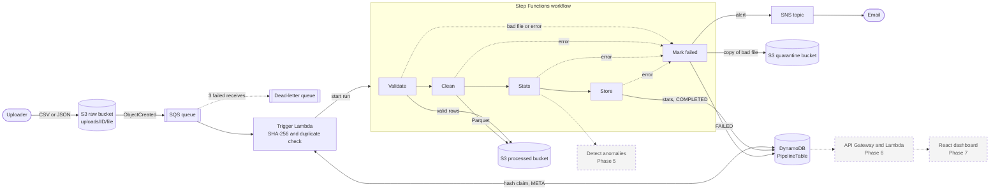
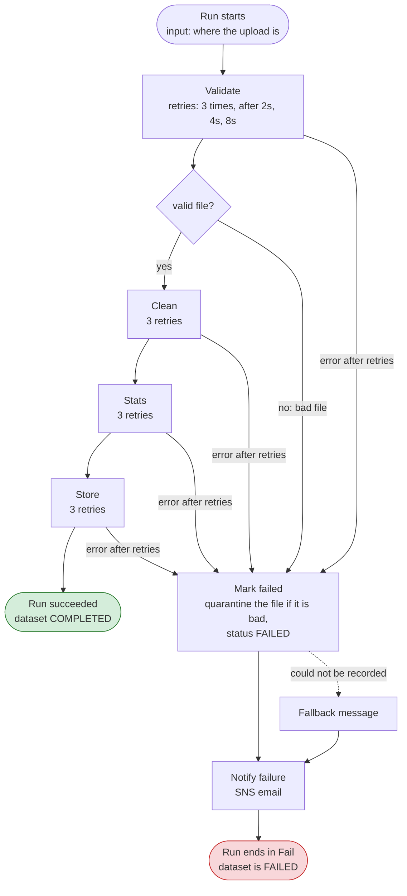
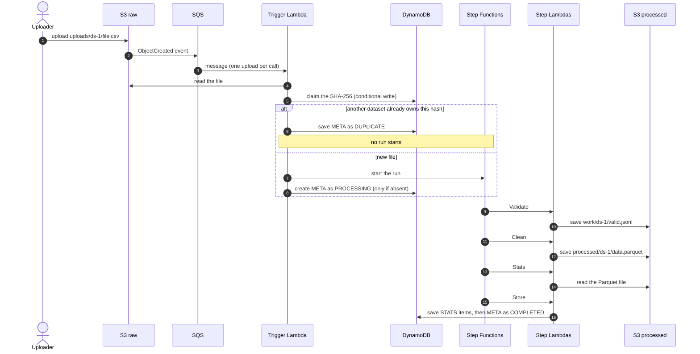
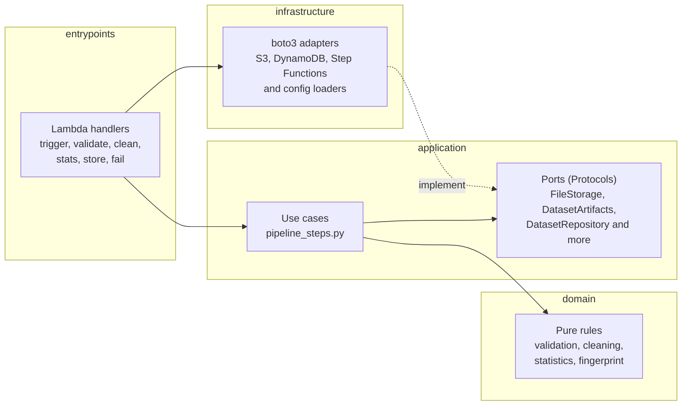

# GradeFlow: Serverless Data Pipeline for Education Analytics

An event-driven AWS pipeline that validates, cleans, analyses and flags anomalies in
student results datasets, then serves the results through an API to a web dashboard.

> 🚧 Work in progress, being built phase by phase. See [Roadmap](#roadmap).

## Architecture



Solid boxes are built and deployed (up to v0.4.0). Dashed boxes are planned in later phases.

## What works today (v0.4.0)



What one good upload looks like, step by step:



Upload a CSV or JSON file to `uploads/<dataset_id>/<filename>`. S3 sends an event to an SQS
queue. A **Trigger Lambda** fingerprints the file (SHA-256) and claims it in DynamoDB with a
conditional write: if a *different* dataset already owns that hash the upload is recorded as
`DUPLICATE` (`duplicate_of` names the original) and nothing else happens. Otherwise it starts a
**Step Functions** state machine ([statemachine/pipeline.asl.json](statemachine/pipeline.asl.json)),
whose steps are separate Lambdas:

| Step | What it does | Hands over |
|---|---|---|
| **Validate** | File-level checks (readable UTF-8, `.csv`/`.json`, rows, required columns) and row-level checks (the rules below). Saves the valid rows. | S3 key of the valid rows, row counts, the first 20 row errors |
| **Clean** | pandas: trims text, normalises subjects (`maths` → `Maths`, `ict` → `ICT`), casts `year`/`score`, drops exact duplicates. Writes `processed/<id>/data.parquet`. | the Parquet key, cleaned row count |
| **Stats** | Per subject and term, overall, top 5 / bottom 5 students, class averages. | the statistics as JSON (about 3 KB) |
| **Store** | Deletes old `STATS#` items, saves the new ones, then writes `META` as `COMPLETED` (last, so completed means everything is there). | final status |
| **Mark failed** | Records `FAILED` with the reason. A bad file is also copied to the quarantine bucket; a crashed run is not (the file may be fine). | |

Steps never pass large data through the workflow (the limit is 256 KB): they hand each other
S3 keys and small results, and the state machine merges each result into the run's state.
Every step runs with its own least-privilege role. For example Stats can only read the
processed bucket, and Store can only use DynamoDB.

If fewer than `MinValidRatio` (default 80%) of the rows are valid, or the file itself is
unusable, the dataset is `FAILED`. That is a normal result, not an error, so it is not retried.

| Column | Rule |
|---|---|
| `student_id` | required, `S` + 5 digits (e.g. `S00123`) |
| `student_name`, `class`, `subject` | required, non-empty |
| `term` | one of `T1`, `T2`, `T3` |
| `year` | integer, 2000 to the upload year |
| `score` | number, 0 to 100 |

### Reliability

| Situation | What happens |
|---|---|
| Same file uploaded again under a new ID | `DUPLICATE`, no workflow starts. The hash claim is atomic, so simultaneous uploads cannot both win. |
| The same S3 event delivered twice by SQS (at-least-once) | Same execution name, so no second run starts. |
| Same bytes uploaded again to the **same** ID later | A new run reprocesses it. The old status stays visible until the new run finishes. |
| Broken or mostly-invalid file | Validate says `valid=false`, so Mark failed quarantines it, sets `FAILED` with the reason and sends an alert. No retries (retrying cannot fix a bad file). |
| A step fails temporarily (S3 throttling, timeout) | That step is retried up to 3 more times, waiting 2, 4 then 8 seconds. |
| A step still fails after its retries | Mark failed sets `FAILED` with a readable reason (no quarantine), then an alert is sent. |
| Recording the failure fails too | The alert is still sent, with a fallback message. |
| The Trigger fails (infrastructure error, malformed message) | The Lambda raises, SQS retries, and after 3 receives the message goes to the **DLQ** (kept 14 days). |
| Re-processing an existing dataset ID | Old `STATS#` items are deleted before the new ones are written. |

A failed file keeps its hash claim, so re-uploading the same broken file under a new ID is
reported as a `DUPLICATE` of the first one.

### Failure alerts

Failed runs publish to an SNS topic. Pass your address at deploy time to get an email:
`sam deploy --parameter-overrides AlertEmail=you@example.com`. AWS sends a confirmation link
you must click once, and until then nothing is delivered. With no address the topic exists but
has no subscribers.

### DynamoDB items (table `PipelineTable`)

| PK | SK | Content |
|---|---|---|
| `DATASET#<id>` | `META` | status, filename, row counts (`total`/`valid`/`invalid`/`clean`), `duplicates_removed`, `row_errors`, `file_hash`, `processed_key`, `quarantine_key`, `duplicate_of`, `error_message` |
| `DATASET#<id>` | `STATS#OVERALL` | count, mean, median, std, min, max, pass rate, `student_count`, top 5 / bottom 5 students, class averages |
| `DATASET#<id>` | `STATS#SUBJECT#<subject>#<term>` | the same metrics for one subject and term |
| `HASH#<sha256>` | `HASH` | `dataset_id` that first uploaded this exact file (duplicate detection) |

Pass rate is the percentage of scores at or above `PassMark` (default 50). All numbers are
rounded to 2 decimals. Results for the default sample file (seed 42):

| | |
|---|---|
| Rows | 904 uploaded → 894 valid → 891 after removing 3 duplicates |
| Overall | mean 62.43, median 62, std 16.12, pass rate 78.34% |
| Students / classes | 60 students; `10-A` 62.11, `10-B` 62.75 |
| Subject/term items | 15 (5 subjects × 3 terms) |

## Code architecture

The Python code follows **clean architecture**. Dependencies only point inward:

| Layer | Folder | Contains | May depend on |
|---|---|---|---|
| Domain | `src/gradeflow/domain/` | Entities, pure rules (validation, stats, anomalies) | nothing (pandas allowed) |
| Application | `src/gradeflow/application/` | Use cases, ports (interfaces) | domain |
| Infrastructure | `src/gradeflow/infrastructure/` | boto3 adapters (S3, DynamoDB), config | application, domain |
| Entrypoints | `src/gradeflow/entrypoints/` | Thin Lambda handlers | all of the above |



Business logic is testable without AWS, and `tests/unit/test_architecture.py` fails the
build if an inner layer imports boto3 or an outer layer.

## Tech stack

Python 3.12 · AWS SAM · Lambda · S3 · SQS · Step Functions · DynamoDB · API Gateway ·
pandas · scikit-learn · pytest · moto · ruff · React + Vite + Recharts · GitHub Actions

## Local setup

Requirements: Python 3.12, git. For deploying you also need the AWS CLI and SAM CLI (Docker
is needed later, from Phase 5). See [docs/aws-setup.md](docs/aws-setup.md).

```bash
python3.12 -m venv .venv
source .venv/bin/activate
pip install -r requirements-dev.txt
```

### Generate sample data

All data is **synthetic**. The generator deliberately injects problems (missing values,
out-of-range scores, duplicates, inconsistent subject casing, bad IDs, score jumps) so the
pipeline has something to catch.

```bash
python scripts/generate_sample_data.py                 # data/student_results.csv
python scripts/generate_sample_data.py --format json   # data/student_results.json
python scripts/generate_sample_data.py --students 200 --seed 7
```

The same `--seed` always produces the same file, which makes results reproducible.

### Run checks

```bash
ruff check .                # lint
ruff format --check .       # formatting
pytest                      # all tests
pytest tests/unit           # fast, pure Python (domain, use cases, handler, config)
pytest tests/integration    # S3 + DynamoDB adapters against moto (fake AWS, no account needed)
```

## Deploy to AWS

Prerequisites: an AWS account set up as in [docs/aws-setup.md](docs/aws-setup.md), plus the
AWS CLI and SAM CLI (`brew install aws-sam-cli`). The stack deploys to `ap-south-1` by default
(see `samconfig.toml`).

```bash
aws sts get-caller-identity   # make sure you're using your IAM user, not root
sam validate
sam build
sam deploy                    # shows the change set, then asks for confirmation
```

Optional parameters, e.g. `sam deploy --parameter-overrides MinValidRatio=0.9 PassMark=40 AlertEmail=you@example.com`.

pandas and pyarrow come from the **AWS SDK for pandas** managed Lambda layer (parameter
`PandasLayerArn`, default is the `ap-south-1` / Python 3.12 / arm64 layer). In another region,
pick the ARN from <https://aws-sdk-pandas.readthedocs.io/en/stable/layers.html> and pass it with
`--parameter-overrides`.

### Try it

Paste only the code blocks. (zsh does not treat `#` as a comment when pasting, so no comments
are included inside them.) First set up the shell helpers:

```bash
export AWS_PAGER=""
out() { aws cloudformation describe-stacks --stack-name gradeflow --region ap-south-1 \
  --query "Stacks[0].Outputs[?OutputKey=='$1'].OutputValue" --output text; }
BUCKET=$(out RawBucketName); PROCESSED=$(out ProcessedBucketName); QUARANTINE=$(out QuarantineBucketName)
TABLE=$(out PipelineTableName); SM=$(out PipelineStateMachineArn); QUEUE=$(out UploadQueueUrl); DLQ=$(out DeadLetterQueueUrl)
meta() { aws dynamodb get-item --table-name $TABLE --region ap-south-1 \
  --key "{\"PK\":{\"S\":\"DATASET#$1\"},\"SK\":{\"S\":\"META\"}}" \
  --query "Item.{status:status.S,dup_of:duplicate_of.S,clean:clean_rows.N,quarantine:quarantine_key.S,error:error_message.S}"; }
steps() { aws stepfunctions get-execution-history --execution-arn "$1" --region ap-south-1 \
  --query "events[?contains(type, 'StateEntered')].stateEnteredEventDetails.name" --output text; }
last_execution() { aws stepfunctions list-executions --state-machine-arn $SM --region ap-south-1 \
  --max-results 1 --query "executions[0].executionArn" --output text; }
python scripts/generate_sample_data.py --seed 7 --out data/sample_seed7.csv
```

`steps $(last_execution)` shows the **newest** run, whichever dataset it belongs to. A duplicate
starts no run, so always check that the output belongs to the upload you just made.

**1. A good file: every step runs.** Open the Step Functions console (Mumbai) → the state
machine → the newest run to see the graph with every state green.

```bash
aws s3 cp data/sample_seed7.csv s3://$BUCKET/uploads/demo-1/sample_seed7.csv
sleep 40
meta demo-1
steps $(last_execution)
aws dynamodb get-item --table-name $TABLE --region ap-south-1 \
  --key '{"PK":{"S":"DATASET#demo-1"},"SK":{"S":"STATS#OVERALL"}}' \
  --query "Item.{count:count.N,mean:mean.N,median:median.N,pass_rate:pass_rate.N,students:student_count.N}"
```

Expect `COMPLETED`, clean 891, steps `Validate IsValid Clean Stats Store`, and mean 64.07 /
median 64.5 / pass rate 89.23 / 60 students.

**2. The same file under a new ID is skipped** (no new run starts):

```bash
aws s3 cp data/sample_seed7.csv s3://$BUCKET/uploads/demo-2/sample_seed7.csv
sleep 15
meta demo-2
```

Expect `DUPLICATE` with `dup_of` = demo-1.

**3. A broken file takes the failure branch.** The bytes must be new: this exact content may
already be claimed by an earlier test.

```bash
printf 'student_id,score\nS00002,%s\n' $RANDOM > /tmp/broken.csv
aws s3 cp /tmp/broken.csv s3://$BUCKET/uploads/demo-3/broken.csv
sleep 30
meta demo-3
steps $(last_execution)
aws s3 ls s3://$QUARANTINE/quarantine/demo-3/
```

Expect `FAILED` (missing required columns), a quarantine key, steps
`Validate IsValid MarkFailed NotifyFailure PipelineFailed`, and the file in quarantine. The run
itself ends `FAILED` (red in the console): that is how a handled failure looks.

**4. Retries and the catch.** Start a run by hand for a file that does not exist:

```bash
ACCT=$(aws sts get-caller-identity --query Account --output text)
aws stepfunctions start-execution --state-machine-arn $SM --name manual-missing-1 --region ap-south-1 \
  --input "{\"dataset_id\":\"demo-4\",\"bucket\":\"$BUCKET\",\"key\":\"uploads/demo-4/missing.csv\",\"uploaded_at\":\"2026-01-01T10:00:00+00:00\",\"file_hash\":\"$(printf '1%.0s' {1..64})\"}"
sleep 45
meta demo-4
steps "arn:aws:states:ap-south-1:${ACCT}:execution:${SM##*:}:manual-missing-1"
```

Expect `FAILED` with `processing failed (NoSuchKey: …)` and no quarantine. In the console the
Validate step shows 4 attempts (the first try plus 3 retries, about 2, 4 and 8 seconds apart).

**5. A poison message ends up in the DLQ** (about 9 minutes: each retry waits for the 3-minute
visibility timeout):

```bash
aws sqs send-message --queue-url $QUEUE --message-body 'not json' --region ap-south-1
```

Later, check the DLQ, then purge it:

```bash
aws sqs get-queue-attributes --queue-url $DLQ --region ap-south-1 \
  --attribute-names ApproximateNumberOfMessages --query Attributes
aws sqs purge-queue --queue-url $DLQ --region ap-south-1
```

Lambda logs: `sam logs -n ValidateFunction --stack-name gradeflow --region ap-south-1 --tail`
(use `TriggerFunction`, `CleanFunction`, `StatsFunction`, `StoreFunction` or `FailFunction`).

### Clean up

The buckets must be empty before CloudFormation can delete them:

```bash
aws s3 rm s3://$BUCKET --recursive
aws s3 rm s3://$PROCESSED --recursive
aws s3 rm s3://$QUARANTINE --recursive
sam delete --stack-name gradeflow --region ap-south-1
```

### Cost

At portfolio-demo volume this stays within the AWS Free Tier:

- Lambda runs on arm64. Memory is sized per step (see Limits): 512 MB Trigger, 2048 MB
  Validate and Clean, 1024 MB Stats, 256 MB Store and Fail. Lambda bills memory times time:
  the 25 MB test file used about 30 GB-seconds in total, against a free tier of 400,000
  GB-seconds a month (roughly 13,000 uploads of that size; typical small files use 1 or 2).
- Step Functions: about 10 state transitions per run, against a free tier of 4,000 a month.
- DynamoDB is on-demand, so it costs nothing when idle.
- Raw and quarantined files expire after 30 days, and the temporary `work/` files after 7.
- SQS and SNS volumes are far inside their free tiers.
- Logs are kept for 14 days.

### Limits

Each step holds the file in memory as Python objects, so memory grows with the number of
rows: measured at about **1.3 MB per 1,000 rows plus about 200 MB** for the runtime and pandas.

Measured on AWS with a 25 MB CSV (525,004 rows): the run finished in 29 seconds with these peak
memory figures.

| Function | Memory | Peak used (25 MB file) |
|---|---|---|
| Trigger | 512 MB | 247 MB |
| Validate | 2048 MB | 842 MB |
| Clean | 2048 MB | 885 MB |
| Stats | 1024 MB | 364 MB |

Extrapolating the same figures, a 50 MB file (about a million rows) should need roughly 1.5 to
1.6 GB in Clean, which fits in 2048 MB. **That size has not been run**: 25 MB is the largest file
verified. Files much beyond 50 MB would need chunked processing, AWS Glue or Fargate, which are
out of scope for this project. Each Lambda also has a 15-minute ceiling (these use 30 to 120 s).

## Roadmap

- [x] Phase 0: Project setup
- [x] Phase 1: MVP pipeline (`v0.1.0`)
- [x] Phase 2: Cleaning & statistics (`v0.2.0`)
- [x] Phase 3: Reliability: SQS, DLQ, idempotency, quarantine (`v0.3.0`)
- [x] Phase 4: Orchestration with Step Functions (`v0.4.0`)
- [ ] Phase 5: Anomaly detection, rule-based + Isolation Forest (`v0.5.0`)
- [ ] Phase 6: Analytics API (`v0.6.0`)
- [ ] Phase 7: Dashboard (`v0.7.0`)
- [ ] Phase 8: Observability & security (`v0.8.0`)
- [ ] Phase 9: CI/CD & release (`v1.0.0`)
