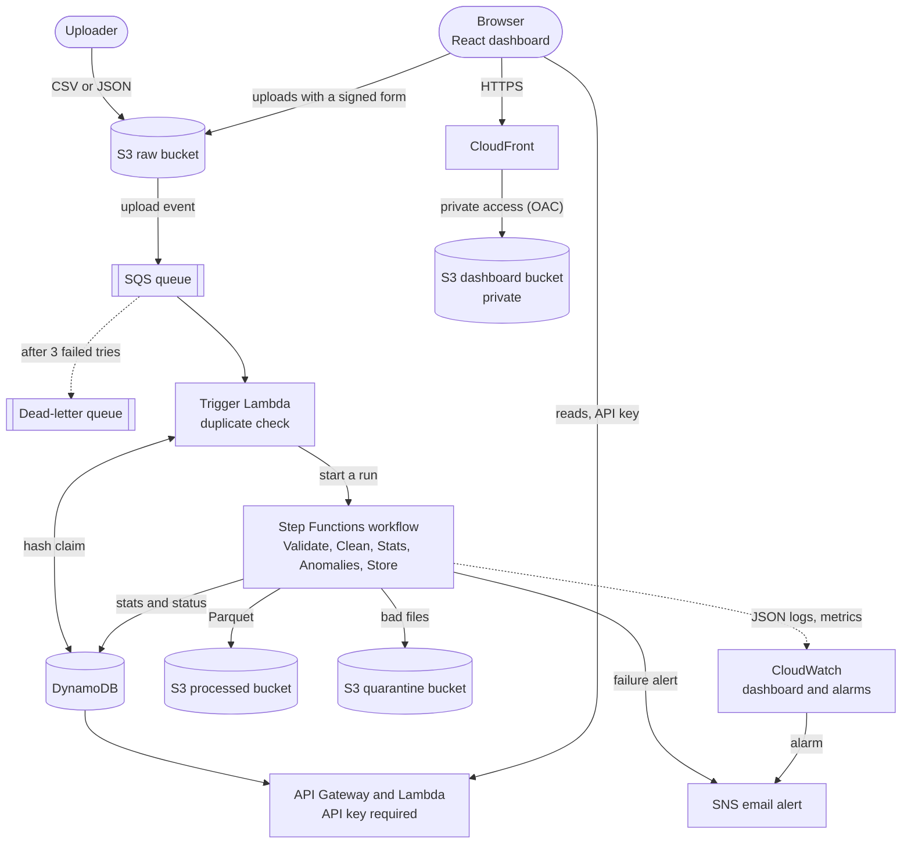
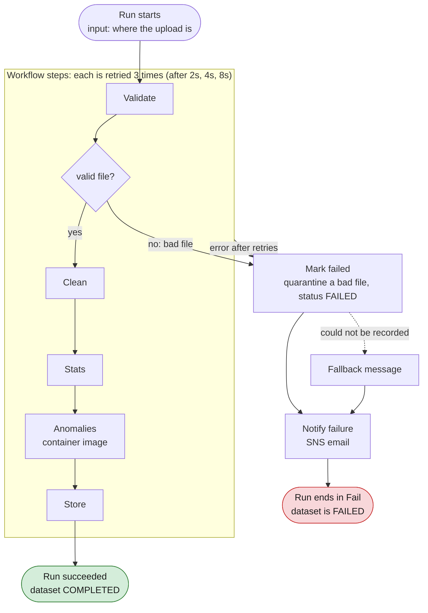
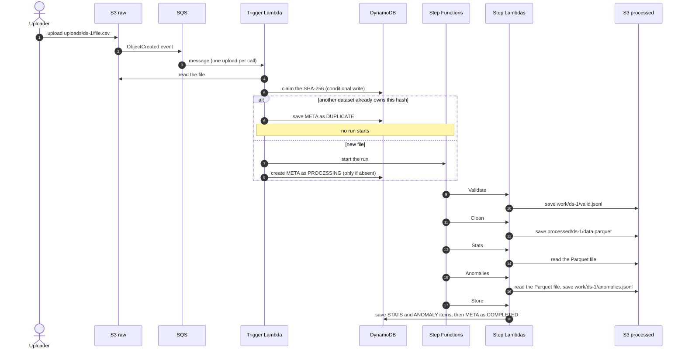
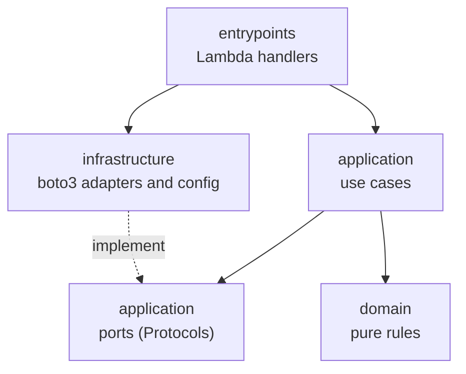

# GradeFlow: Serverless Data Pipeline for Education Analytics

[](https://github.com/dhananjaya-hbc/gradeflow-serverless-pipeline/actions/workflows/ci.yml)

An event-driven AWS pipeline that validates, cleans, analyses and flags anomalies in
student results datasets, then serves the results through an API to a web dashboard.
Upload a CSV or JSON file and a few seconds later the dashboard shows subject averages, pass
rates, top and bottom students, and flagged anomalies (suspicious score jumps, duplicate IDs,
statistical outliers). The whole stack is one SAM template, and every push to `main` that passes
the tests deploys itself with no stored AWS keys.

Built as a learning and portfolio project, phase by phase (see [Roadmap](#roadmap)). All data is
synthetic.

**Contents:** [Features](#features) · [Screenshots and demo](#screenshots-and-demo) ·
[Architecture](#architecture) · [CI/CD](#cicd) · [Design decisions](#design-decisions) ·
[Deploy](#deploy-to-aws) · [Cost](#cost) · [Limits](#limits) · [Future improvements](#future-improvements)

## Features

- **Event-driven processing:** S3 upload, then SQS (with a dead-letter queue), then a Step Functions
  workflow of six Lambdas with per-step retries and a failure branch.
- **Reliable by design:** duplicate uploads are detected by SHA-256 and skipped; bad files are
  quarantined and marked `FAILED`; an email alert is sent on failure.
- **Anomaly detection:** three rule-based detectors (z-score, term-to-term jump, duplicate student ID)
  plus an Isolation Forest running in a container-image Lambda. Reliability was measured, not assumed
  (see [Anomaly detection](#anomaly-detection)).
- **Analytics API:** five REST endpoints behind an API key, with paging, filters and CORS.
- **Dashboard:** React + Recharts, hosted privately on S3 behind CloudFront; upload with progress,
  live status, charts with table alternatives.
- **Observability:** structured JSON logs, 7 custom metrics, a CloudWatch dashboard and 4 alarms.
- **Least-privilege security:** exact IAM statements per function (pinned by tests), TLS-only buckets,
  no public buckets, CSP and security headers on the dashboard.
- **CI/CD:** lint, tests and template checks on every push; deploy from `main` through GitHub OIDC.
- **Well tested:** 1,045 pytest tests (domain, use cases, handlers, adapters on moto, the real
  state machine file run by an emulator, the template, the workflows) and 223 Vitest tests.

## Screenshots and demo

> TODO before sharing: add the images to `docs/screenshots/` and replace this block.

| Datasets list | Dataset detail |
|---|---|
| _screenshot: `docs/screenshots/datasets.png`_ | _screenshot: `docs/screenshots/detail.png`_ |

| CloudWatch dashboard | Step Functions run |
|---|---|
| _screenshot: `docs/screenshots/cloudwatch.png`_ | _screenshot: `docs/screenshots/stepfunctions.png`_ |

Demo video: _link to be added_

## Architecture



Everything in the diagram is built and deployed. The dashboard is a static site: it
talks to the API and uploads straight to S3, with no server of its own.

## How it works



What one good upload looks like, step by step:



Upload a CSV or JSON file to `uploads/<dataset_id>/<filename>`. S3 sends an event to an SQS
queue. A **Trigger Lambda** fingerprints the file (SHA-256) and claims it in DynamoDB with a
conditional write: if a *different* dataset already owns that hash the upload is recorded as
`DUPLICATE` (`duplicate_of` names the original) and nothing else happens. Otherwise it starts a
**Step Functions** state machine ([statemachine/pipeline.asl.json](statemachine/pipeline.asl.json)),
whose steps are separate Lambdas:

| Step | What it does | Hands over |
|---|---|---|
| **Validate** | File-level checks (readable UTF-8, `.csv`/`.json`, rows, required columns) and row-level checks (the rules below). Saves the valid rows. | S3 key of the valid rows, row counts, the first 20 row errors |
| **Clean** | pandas: trims text, normalises subjects (`maths` → `Maths`, `ict` → `ICT`), casts `year`/`score`, drops exact duplicates. Writes `processed/<id>/data.parquet`. | the Parquet key, cleaned row count |
| **Stats** | Per subject and term, overall, top 5 / bottom 5 students, class averages. | the statistics as JSON (about 3 KB) |
| **Anomalies** | Rule-based detectors plus an Isolation Forest, in a **container-image Lambda** (see Anomaly detection below). Writes every finding to S3, ranked. | counts per method and the S3 key |
| **Store** | Deletes old `STATS#` and `ANOMALY#` items, saves the new ones (the most important `MaxAnomalies`), then writes `META` as `COMPLETED` (last, so completed means everything is there). | final status |
| **Mark failed** | Records `FAILED` with the reason. A bad file is also copied to the quarantine bucket; a crashed run is not (the file may be fine). | |

Steps never pass large data through the workflow (the limit is 256 KB): they hand each other
S3 keys and small results, and the state machine merges each result into the run's state.
Every step runs with its own least-privilege role. For example Stats can only read the
processed bucket, and Store can only use DynamoDB.

If fewer than `MinValidRatio` (default 80%) of the rows are valid, or the file itself is
unusable, the dataset is `FAILED`. That is a normal result, not an error, so it is not retried.

| Column | Rule |
|---|---|
| `student_id` | required, `S` + 5 digits (e.g. `S00123`) |
| `student_name`, `class`, `subject` | required, non-empty |
| `term` | one of `T1`, `T2`, `T3` |
| `year` | integer, 2000 to the upload year |
| `score` | number, 0 to 100 |

### Reliability

| Situation | What happens |
|---|---|
| Same file uploaded again under a new ID | `DUPLICATE`, no workflow starts. The hash claim is atomic, so simultaneous uploads cannot both win. |
| The same S3 event delivered twice by SQS (at-least-once) | Same execution name, so no second run starts. |
| Same bytes uploaded again to the **same** ID later | A new run reprocesses it. The old status stays visible until the new run finishes. |
| Broken or mostly-invalid file | Validate says `valid=false`, so Mark failed quarantines it, sets `FAILED` with the reason and sends an alert. No retries (retrying cannot fix a bad file). |
| A step fails temporarily (S3 throttling, timeout) | That step is retried up to 3 more times, waiting 2, 4 then 8 seconds. |
| A step still fails after its retries | Mark failed sets `FAILED` with a readable reason (no quarantine), then an alert is sent. |
| Recording the failure fails too | The alert is still sent, with a fallback message. |
| The Trigger fails (infrastructure error, malformed message) | The Lambda raises, SQS retries, and after 3 receives the message goes to the **DLQ** (kept 14 days). |
| Re-processing an existing dataset ID | Old `STATS#` items are deleted before the new ones are written. |

A failed file keeps its hash claim, so re-uploading the same broken file under a new ID is
reported as a `DUPLICATE` of the first one.

### Failure alerts

Failed runs publish to an SNS topic. Pass your address at deploy time to get an email:
`sam deploy --parameter-overrides AlertEmail=you@example.com`. AWS sends a confirmation link
you must click once, and until then nothing is delivered. With no address the topic exists but
has no subscribers. The same topic receives the CloudWatch alarms (see Observability).

### Anomaly detection

After Stats, the **Anomalies** step looks for data that is *suspicious*, not necessarily wrong: it
flags and explains, and a person decides. Every finding has a reason in words and is stored as an
`ANOMALY#<rank>` item, **most important first**.

**Rule-based detectors** (predictable and explainable):

| Method | Flags | Setting (default) |
|---|---|---|
| `term_jump` | a student's score in one subject changes by more than the threshold between consecutive terms (T1 to T2, T2 to T3). Exactly the threshold is not flagged. | `JumpThreshold` (30 points) |
| `duplicate_id` | one student ID used with different names | none |
| `zscore` | a score more than N standard deviations from the mean of its own subject and term. A group of 10 or fewer can never reach 3, so tiny classes are never flagged. | `ZScoreLimit` (3) |

Each term jump carries a **pattern**, because a big change is not always suspicious:

| Pattern | Meaning | Example (T1, T2, T3) |
|---|---|---|
| `spike` | went back at least halfway to where it started | 34, 77, 38 (flagged twice: up, then back) |
| `sustained` | moved and did not go back | 40, 75, 78 (a likely genuine improvement) |
| `latest` | the change is in the last term, so it cannot be judged yet | 50, 52, 95 |

Spikes rank above lasting changes, even when the lasting change is bigger.

**Machine learning: `isolation_forest`.** Each student is summarised by four numbers: average
score, spread between their subjects, average change between terms, and their largest single
change. An Isolation Forest (scikit-learn, 200 trees, fixed random seed so the same file always gives
the same answer) keeps cutting the data at random: unusual students are isolated after few cuts and
score high. The most unusual `IfContamination` share (5%) is flagged, each with a reason such as
*"largest change between consecutive terms 43.0 points is 4.5 standard deviations above the typical
student (6.0)"*. With fewer than 20 students it is skipped, and META records why (`ml_skipped`).

**Order and storage.** Findings are ranked: `duplicate_id`, then `term_jump` (spike, latest, sustained,
then by size), then `zscore`, then `isolation_forest`. The most important `MaxAnomalies` (500) are
stored as `ANOMALY#00001`, `ANOMALY#00002`, ..., and `META` always records the true total
(`anomaly_count`) next to how many were stored (`anomalies_stored`).

Results for the default sample file (seed 42), as stored in DynamoDB and verified on AWS:

| Rank | Method | Student | Pattern | Severity |
|---|---|---|---|---|
| 1 | `duplicate_id` | S00045 | none | 2.0 (two names) |
| 2 to 5 | `term_jump` | S00040, S00055 (two each) | spike | 46.9, 44.8, 39.1, 34.8 |
| 6 | `term_jump` | S00034 | sustained (34, 77, 99) | 42.6 |
| 7 to 9 | `isolation_forest` | S00034, S00055, S00040 | none | 0.739, 0.667, 0.655 |

The three planted score jumps and the planted duplicate ID are all found. There are no `zscore`
findings: the sample has no extreme single score (the planted out-of-range scores are rejected in
validation).

**How reliable is it?** Measured on 80 generated files (20 seeds, class sizes 30, 60, 120 and 300),
each with 3 planted jumps and 1 planted duplicate ID:

| Detector | Planted anomalies found |
|---|---|
| Rule-based term jumps | all 3, in **80 of 80** files |
| Rule-based duplicate ID | the planted one and nothing else, in **80 of 80** files |
| Isolation Forest, 60 students, 5% | **82% on average**, all three in 11 of 20 files |
| Isolation Forest, 60 students, 10% | 98%, but only about half of its flags are planted ones |
| Isolation Forest, 300 students, 5% | 100% (20 of 20) |

The rules are the dependable detectors. The forest is a **second opinion**: it finds students whose
whole profile is unusual, which includes genuinely weak or erratic students that were not planted,
so some of its "misses" and "extras" are legitimate.

**Limits to know about**
- **A flag is a question, not a verdict.** A genuine breakthrough or a bad term (illness) is flagged
  too. The pattern and the reason help, but a teacher decides.
- Jumps are measured against the **student's own earlier score, not the class**. If a term's exam
  was much harder for everyone, many students will be flagged. A class-relative version is not built.
- The sample data wobbles by only about 6 points a term, so real data will probably produce more
  flags than the synthetic files do.

**Speed.** On a warm container the whole pipeline took 1.6 seconds for a 904-row file, with
the Anomalies step at 0.4 s. The **first start after a deploy** is slow: the container image is
loaded lazily from ECR, the init phase hit Lambda's 10-second limit, and Lambda re-ran it
inside the invocation. That run took 75 seconds, of which about 47 s was loading libraries and 3 s
was real work. The step's 300-second timeout (and the state machine's retries) cover this.
The `joblib will operate in serial mode` warning in its logs is harmless: Lambda has no shared
memory for it, so it runs single-threaded.

### Analytics API

A REST API (API Gateway + one Lambda) serves what the pipeline stores. It only **reads** (the
Lambda has `GetItem` and `Query` on the table and nothing else) and signs upload forms. Every
route needs the **`x-api-key`** header.

| Method and path | Returns |
|---|---|
| `POST /uploads` | body `{"filename": "results.csv"}`: a **pre-signed S3 upload form** for a new dataset. The server picks the dataset id (`ds-<date>-<random>`), so nobody can upload under an existing id. Only `.csv` and `.json`. |
| `GET /datasets` | datasets, **newest first**, with status and counts. `?limit=` (1 to 100, default 20) and `?cursor=` for the next page. |
| `GET /datasets/{id}` | the record plus its validation report: row counts, row errors, error message, cleaning counts, anomaly counts. |
| `GET /datasets/{id}/stats` | overall stats, per-subject and term stats, top and bottom students, class averages. Empty (not an error) while the dataset is unfinished or failed. |
| `GET /datasets/{id}/anomalies` | findings in rank order. `?method=` (`term_jump`, `duplicate_id`, `zscore`, `isolation_forest`), `?limit=` (1 to 500, default 100) and `?cursor=`. |

**Paging.** A page that has more after it carries `next_cursor`: pass it back as `?cursor=`. The last
page has `next_cursor: null`, so a client stops there. A cursor is only a position and the dataset always
comes from the URL, so a forged or borrowed cursor can never read another dataset.

**Errors** always look the same: `{"error": {"code": "...", "message": "..."}}`.

| Status | When |
|---|---|
| 400 | bad `limit`, `method`, `cursor`, dataset id, JSON body or filename (`invalid_limit`, `invalid_method`, `invalid_cursor`, `invalid_dataset_id`, `invalid_json`, `invalid_filename`, `unsupported_file_type`) |
| 403 | no API key, a wrong key, or a route that does not exist (API Gateway's own `Forbidden` / `Missing Authentication Token`) |
| 404 | unknown dataset |
| 413 | request body over 4 KB |
| 429 | too many requests (usage plan) |
| 500 | something unexpected, or Lambda was at its concurrency limit (see Limits) |

**Uploading through the API** takes two steps: ask for a signed form, then post the file straight to S3
with it. S3 itself enforces what was signed: this one key, **1 byte to 50 MB**, valid for 15 minutes
(an empty file is refused with `EntityTooSmall`). [scripts/api_upload.py](scripts/api_upload.py) does both
steps. The upload then goes through the normal pipeline.

**Security, honestly.** The API key is a gate against casual abuse and a way to rate-limit, **not real
authentication**. A dashboard that ships the key in its JavaScript exposes it, and anyone who holds the key
can read every dataset and start uploads. The usage plan limits damage (5 requests per second, burst 10, 5,000
a day). The data is synthetic. Cognito is the later upgrade. The API's CORS still allows any origin
(`AllowedOrigin=*`; see the Dashboard section for how to tighten it), while the raw bucket's CORS rule for
browser uploads allows only POST from the dashboard.

### Dashboard

A React single-page app, served privately from S3 through CloudFront. It has three pages:

| Page | Address | What it does |
|---|---|---|
| Datasets | `#/` | Newest-first table with status badges, row and anomaly counts, "Load more". While anything is processing it refreshes by itself: every 5 s for 2 minutes, then every 15 s, and **stops after 10 minutes** (a Refresh button remains), so a stuck dataset cannot use up the API's daily quota. It also pauses while the tab is hidden. |
| Upload | `#/upload` | Pick or drop a `.csv` or `.json` (up to 50 MB, checked before sending). The page asks the API for a signed form, posts the file straight to S3 with a progress bar, then waits until the dataset exists. S3 errors become plain sentences (empty file, too large, expired link, blocked by CORS). |
| Dataset detail | `#/datasets/<id>` | Summary cards (rows, students, average, pass rate, anomalies), a bar chart of subject averages, a line chart of term trends, top and lowest students, class averages, the validation report, and the anomalies table with a method filter (asked of the server), a student search and "Load more". Failed datasets show the reason, duplicates link to the dataset they repeat. Every chart has a "Show as table" version with the same numbers. |

How it is built:

- **React 19, Vite 8, TypeScript (strict), Recharts, React Router** with hash routes (`#/...`), so
  CloudFront needs no rewrite rules.
- **Runtime configuration.** The build contains no address and no key. The page loads `config.json`
  (written by the deploy script) when it starts, so one build works for any stack.
- **A careful API client.** A new AWS account allows only 10 concurrent Lambda executions (see Limits), so
  the client keeps at most 4 requests in flight and retries 429, 5xx and network failures up to 4 times with
  an exponential backoff (0.3 s doubling, at most 5 s, honouring `Retry-After`). Client errors such as 404
  are never retried.
- **Accessible and responsive.** Light and dark themes, a skip link, labelled and keyboard-scrollable tables,
  a visible focus outline, per-page tab titles, and a layout that reflows to phone width. The colour pairs
  are checked in a test against the WCAG contrast minimums (4.5:1 for text, 3:1 for chart lines), in both themes.
- **Tested against real responses.** 223 Vitest tests, using JSON captured from the deployed API as fixtures
  (for example mean 62.43, pass rate 78.34%, 60 students and the nine anomalies of `demo-030`). The polling
  schedule is tested with fake timers, the upload with a fake `XMLHttpRequest`.

How it is hosted and secured:

- The site lives in a **private** S3 bucket. Only the CloudFront distribution can read it, through an
  **origin access control** (the bucket policy allows `s3:GetObject` for that one distribution and nothing else).
  HTTP is redirected to HTTPS.
- CloudFront adds security headers: HSTS, `X-Content-Type-Options`, `X-Frame-Options: DENY`,
  `Referrer-Policy: no-referrer` and a **Content Security Policy** that allows only the site's own scripts,
  and connections only to itself, API Gateway in the region and the raw bucket.
- `config.json` is never cached (it holds the key); hashed asset files are cached for a year.
- The raw bucket has a **CORS rule that allows only POST** from the deployed dashboard (and, optionally,
  `http://localhost:5173` for development; the `DashboardDevOrigin` parameter, empty to switch it off).

Honest limits of this version:

- **The API key is visible to anyone who opens the site** (it is in `config.json`). It limits and meters use,
  it is not a login. Real sign-in (Cognito) is a later option, so treat the data as public. It is synthetic.
- The API's own CORS origin is still `*` (parameter `AllowedOrigin`). Setting it to the dashboard address
  tightens it, at the price of breaking `npm run dev` against the deployed API.
- The CSP names API Gateway as `*.execute-api.<region>.amazonaws.com` because naming this stack's API would
  make the template circular (a test checks the template has no dependency cycle).
- The JavaScript bundle is about 680 kB (200 kB compressed), mostly Recharts. Lazy-loading the charts would
  shrink the first load; it was left out to keep the code simple.

### DynamoDB items (table `PipelineTable`)

| PK | SK | Content |
|---|---|---|
| `DATASET#<id>` | `META` | status, filename, row counts (`total`/`valid`/`invalid`/`clean`), `duplicates_removed`, `row_errors`, `file_hash`, `processed_key`, `quarantine_key`, `duplicate_of`, `anomaly_count`, `anomalies_stored`, `ml_skipped`, `error_message` |
| `DATASET#<id>` | `STATS#OVERALL` | count, mean, median, std, min, max, pass rate, `student_count`, top 5 / bottom 5 students, class averages |
| `DATASET#<id>` | `STATS#SUBJECT#<subject>#<term>` | the same metrics for one subject and term |
| `DATASET#<id>` | `ANOMALY#<rank>` | one finding: `method`, `student_id`, `student_name`, `subject`, `term`, `score`, `pattern`, `severity`, `details` (the reason). Rank 1 is the most important. |
| `HASH#<sha256>` | `HASH` | `dataset_id` that first uploaded this exact file (duplicate detection) |

Pass rate is the percentage of scores at or above `PassMark` (default 50). All numbers are
rounded to 2 decimals. Results for the default sample file (seed 42):

| | |
|---|---|
| Rows | 904 uploaded → 894 valid → 891 after removing 3 duplicates |
| Overall | mean 62.43, median 62, std 16.12, pass rate 78.34% |
| Students / classes | 60 students; `10-A` 62.11, `10-B` 62.75 |
| Subject/term items | 15 (5 subjects × 3 terms) |

### Permissions (IAM review)

Every function has its own role, and each may do exactly what its step does, on exactly the keys it
touches. `tests/unit/test_iam_least_privilege.py` pins this on the template **as SAM expands it** (SAM
adds some policies by itself, so the YAML alone does not show the real roles).

| Role | May do | On |
|---|---|---|
| Trigger | read; list; read and write items; start a run; receive, delete and inspect messages | raw `uploads/*`; the raw bucket (list only); the table; the state machine; the upload queue only |
| Validate | read; list; write | raw `uploads/*`; the raw bucket (list only); processed `work/*` |
| Clean | read; write | processed `work/*`; processed `processed/*` |
| Stats | read only | processed `processed/*` |
| Anomalies | read; write | processed `processed/*`; processed `work/*` |
| Store | read; write, query and delete items | processed `work/*`; the table |
| Fail | read (the copy's source); write; write items | raw `uploads/*`; quarantine `quarantine/*`; the table |
| API | read items; sign upload forms | the table and its index (no scan, no writes); raw `uploads/*` (write, only through signed forms) |
| State machine | invoke the six steps; publish | those six functions by exact ARN; the alert topic |
| CloudFront | read | the dashboard bucket, and only for that one distribution |
| CloudWatch alarms | publish | the alert topic, only alarms of this stack |

What the review removed:

- **The Trigger's managed SQS policy.** SAM attaches AWS's `AWSLambdaSQSQueueExecutionRole` for an `Events: SQS`
  entry; it allows receiving from and deleting on **every queue in the account**. The queue is now connected
  by an explicit event source mapping and the Trigger has three SQS actions on the upload queue only. (The
  mapping keeps the logical ID SAM generated, so the deploy updates it in place: a new ID would create a second
  mapping first, which Lambda refuses.)
- **Unused S3 actions** that SAM's `S3ReadPolicy` and `S3WritePolicy` templates include:
  `s3:PutLifecycleConfiguration` (a compromised function could change when files are deleted), `s3:PutObjectAcl`,
  `s3:GetBucketLocation`, `s3:GetObjectVersion` and `s3:GetLifecycleConfiguration`.
- **Whole-bucket access.** Each step now reaches one key prefix (`uploads/`, `work/`, `processed/`, `quarantine/`)
  and nothing else in the bucket.
- **A name-prefix wildcard** in the state machine's invoke permission (`function:<name>*`, from SAM's
  `LambdaInvokePolicy`). It now lists the six functions' exact ARNs.
- **Plain HTTP.** Every bucket has a policy that refuses requests not made over HTTPS.

Deliberately left as it is, and why:

- **`AWSLambdaBasicExecutionRole`** (AWS's standard policy) on every function: it lets a function write log
  lines, but to any log group in the account, not only its own. Scoping it needs a hand-written role per
  function; the risk is low (it cannot read or change anything), so it was kept and documented.
- **`s3:ListBucket` on the raw bucket** for the Trigger and Validate. Without it S3 answers "access denied" for a
  missing file instead of "not found", which would make a bad upload harder to diagnose. It only reveals key names.
- **Table-wide DynamoDB access** for the Trigger, Store and Fail (exact actions, no `Scan`, no
  `UpdateItem`). Limiting them to key prefixes with `dynamodb:LeadingKeys` conditions was judged more complexity
  than it is worth for one table with one owner.
- **The API key** in the dashboard is public by design (see Dashboard), so the API's reach is capped by what its
  role can do (read-only on the table), not by the key.

### Observability

Logs, metrics, a dashboard and alarms, all built from the same few pieces and checked on the deployed stack.

**Logs.** Every Lambda writes one JSON object per line (Powertools), with the Lambda request id, function
name, a cold-start flag and, for every workflow step, the `dataset_id`. A crash is logged as one `ERROR` line
with the traceback and the `dataset_id` before it is raised again, so Step Functions still retries. Logs hold
counts and dataset ids only, never student names, IDs or rejected rows (a test runs a whole good and a failed
dataset and checks). Set the level with the `LogLevel` parameter (`INFO` by default, `DEBUG` to investigate:
`sam deploy --parameter-overrides LogLevel=DEBUG`).

Follow one dataset through every step in CloudWatch Logs Insights (select the seven step log groups, or use
the CLI), for example:

```
fields @timestamp, message, function_name
| filter dataset_id = "ds-20261016-46577387"
| sort @timestamp asc
```

On the sample file that returns, in order: `upload processed`, `validation finished`, `cleaning finished`,
`statistics computed`, `anomaly detection finished`, `dataset stored`. Everything that went wrong in the last
hour: `filter level = "ERROR"`. Files rejected by validation are `WARNING`.

**Metrics.** Seven custom counters in the `GradeFlow` namespace, published as log lines (embedded metric format,
so no extra permission is needed). Each handler records its counts as its last action, after its work has
succeeded, and a handler that fails publishes nothing: a step that crashes is retried, and counting before the
crash would count the retry twice.

| Metric | Counted by | When |
|---|---|---|
| `RowsReceived`, `RowsRejected` | Validate | every run (a wrong-columns file counts 0) |
| `AnomaliesFound`, `DatasetsCompleted` | Store | per completed dataset (the true total found) |
| `DatasetsFailed` | Fail | bad files and crashes |
| `DuplicatesSkipped` | Trigger | an upload identical to an earlier file |
| `ApiServerErrors` | API | responses with status 500 or above |

Counts are approximate under retries (SQS delivers at least once), and re-processing the same dataset id counts
its anomalies again. A metric appears in CloudWatch 1 to 2 minutes after its first use.

**Dashboard.** `gradeflow-pipeline`: alarm status, datasets, rows, anomalies, Lambda errors, throttles and p95
duration per function, queue depth (upload and dead-letter), Step Functions runs, and API requests, errors and
latency. Its address is the `PipelineDashboardUrl` stack output:

```bash
aws cloudformation describe-stacks --stack-name gradeflow --region ap-south-1 --query "Stacks[0].Outputs[?OutputKey=='PipelineDashboardUrl'].OutputValue" --output text
```

**Alarms** (each notifies the alert topic when it fires and when it recovers; a service that is idle counts as
healthy, not broken):

| Alarm | Fires when | What to do |
|---|---|---|
| `gradeflow-lambda-errors` | any of the 8 functions raises an error in 5 minutes (one alarm over all of them) | open the dashboard, then search that function's log group for `level = "ERROR"` |
| `gradeflow-lambda-throttles` | Lambda refuses to start a function (the account limit of 10 concurrent executions) | raise the quota (see Limits) |
| `gradeflow-dead-letter-queue` | one or more messages are in the dead-letter queue | receive the message, fix the cause, purge the queue |
| `gradeflow-api-server-errors` | 3 or more 5XX answers in 5 minutes (counts the ones API Gateway makes when Lambda is throttled, which our code never sees) | check the Lambda alarms and the dashboard |

A failed pipeline run (a bad file) is deliberately not an alarm: it is a normal outcome and already sends one
email through the failure branch.

To get emails, deploy with a real address (`sam deploy --parameter-overrides AlertEmail=you@your-address.com`)
and click the confirmation link AWS sends. Until then the alarms still change state and publish, but nothing
reaches an inbox (`aws sns list-subscriptions-by-topic` shows `PendingConfirmation`).

**Try the alarms.** Both commands change AWS. First force a Lambda error: a run for a file that does not exist
makes Validate raise `NoSuchKey` four times (the try plus 3 retries), and leaves one `FAILED` dataset:

```bash
SM=$(aws cloudformation describe-stacks --stack-name gradeflow --region ap-south-1 --query "Stacks[0].Outputs[?OutputKey=='PipelineStateMachineArn'].OutputValue" --output text)
RAW=$(aws cloudformation describe-stacks --stack-name gradeflow --region ap-south-1 --query "Stacks[0].Outputs[?OutputKey=='RawBucketName'].OutputValue" --output text)
aws stepfunctions start-execution --state-machine-arn $SM --name alarm-test-1 --region ap-south-1 --input "{\"dataset_id\":\"alarm-test-1\",\"bucket\":\"$RAW\",\"key\":\"uploads/alarm-test-1/missing.csv\",\"uploaded_at\":\"2026-01-01T10:00:00+00:00\",\"file_hash\":\"$(printf '2%.0s' {1..64})\"}"
```

On the deployed stack `gradeflow-lambda-errors` went `OK` to `ALARM` about 1 min 40 s later, and CloudWatch
recorded `Successfully executed action` for the alert topic; it returns to `OK` by itself after about 5 to 10
minutes without errors. Use a new `--name` each time. To clear a message from the dead-letter queue (this
deletes it for good):

```bash
DLQ=$(aws cloudformation describe-stacks --stack-name gradeflow --region ap-south-1 --query "Stacks[0].Outputs[?OutputKey=='DeadLetterQueueUrl'].OutputValue" --output text)
aws sqs purge-queue --queue-url $DLQ --region ap-south-1
```

The dead-letter alarm was back to `OK` within about 7 minutes of the purge (SQS metrics arrive in 5 minute steps).

**Startup time (measured on AWS, first call after a deploy).** The zip steps start cold in about 1.8 s each, mostly
the pandas layer (Powertools and its two dependencies add 6.2 MB unzipped, and the function packages are about
1 MB); warm calls take 47 to 105 ms. The Anomalies container hit Lambda's 10 second init limit, so Lambda re-ran
init inside the invocation and the step took 53.7 s (61 s in Phase 5, so Powertools did not make it worse);
its 300 s timeout covers that, and a warm run is under 2 s.

## CI/CD

One workflow, [`.github/workflows/ci.yml`](.github/workflows/ci.yml), with four jobs:

| Job | Runs on | What it does |
|---|---|---|
| `python` | every push and PR | `ruff check`, `ruff format --check`, `pytest` |
| `dashboard` | every push and PR | `npm ci`, typecheck, Vitest, production build |
| `template` | every push and PR | `sam validate --lint` |
| `deploy` | push to `main` only, after the three above | `sam build` and `sam deploy`, dashboard upload, smoke test |

How the deploy gets into AWS **without any stored keys**:

- GitHub proves who it is with a short-lived OIDC token; AWS trusts only this exact repository and the
  `main` branch. The trust uses GitHub's **immutable subject claim** (numeric owner and repository IDs),
  so a deleted-and-recreated repo with the same name cannot assume the role.
- **Two roles.** The deploy role can only start CloudFormation and upload artifacts. CloudFormation then
  builds the stack with a separate **execution role** (`sam deploy --role-arn`) that holds the permissions
  to create each resource type. Neither role can modify the CI roles themselves (explicit deny).
- The role ARNs and the alert email are repository **secrets**, not variables, because this repository
  is public and GitHub prints variables in logs.
- Every third-party action is pinned to a commit SHA, Dependabot keeps them current, and `actionlint`
  plus a JSON-schema check run inside the test suite.
- After deploying, `scripts/smoke_test.py` checks the live dashboard and API (page, security headers,
  cache headers, `config.json`, 200 with the key, 403 without it, CORS preflight).

The execution role's permissions were derived from evidence: CloudTrail records of a real deploy and the
IAM policy simulator, kept as a test fixture. One-time setup is in [docs/ci-cd-setup.md](docs/ci-cd-setup.md).

## Code architecture

The Python code follows **clean architecture**. Dependencies only point inward:

| Layer | Folder | Contains | May depend on |
|---|---|---|---|
| Domain | `src/gradeflow/domain/` | Entities, pure rules (validation, stats, anomalies) | nothing (pandas allowed) |
| Application | `src/gradeflow/application/` | Use cases, ports (interfaces) | domain |
| Infrastructure | `src/gradeflow/infrastructure/` | boto3 adapters (S3, DynamoDB), config | application, domain |
| Entrypoints | `src/gradeflow/entrypoints/` | Thin Lambda handlers | all of the above |



Business logic is testable without AWS, and `tests/unit/test_architecture.py` fails the
build if an inner layer imports boto3 or an outer layer.

## Design decisions

| Decision | Why | Trade-off |
|---|---|---|
| SQS between S3 and the workflow | Buffers bursts, retries, and a poison message lands in a DLQ instead of being lost | About 36 minutes to reach the DLQ with the safe visibility timeout |
| Step Functions instead of one big Lambda | Per-step retries, a visible run history, a clean failure branch | More moving parts; stats travel in the state (limit 256 KB, 3 KB used) |
| A bad file is a returned `valid=false`, not an exception | No pointless retries of something that can never succeed | Needs an explicit Choice state |
| Idempotency by file SHA-256 | Same bytes under a new name are `DUPLICATE`, not reprocessed | A failed file keeps its claim, so a fixed file must have new bytes |
| Single DynamoDB table with a GSI | One table, on-demand, newest-first listing | Access patterns must be designed up front |
| Container image only for Anomalies | scikit-learn does not fit a zip Lambda | 54 s first cold start, 1.45 GB image |
| Isolation Forest as a second opinion | Rules find planted jumps 80/80; the forest adds statistical outliers | Recall depends on dataset size (see below) |
| Powertools via pip, not the managed layer | The pandas layer already uses most of the 250 MB cap | Slightly larger zips |
| Metrics as embedded metric format | No `PutMetricData` permission needed | Metrics appear a minute after the log line |
| REST API with an API key | HTTP APIs have no built-in keys | The key in the browser is public by design: it limits abuse, it is not authentication |
| Clean architecture with a test enforcing it | Business logic runs without AWS | A few more files and ports |
| Hash routes in the dashboard | CloudFront needs no rewrite rules | URLs contain `#` |

## Tech stack

Python 3.12 · AWS SAM · Lambda · S3 · SQS · Step Functions · DynamoDB · API Gateway · CloudFront ·
pandas · scikit-learn · Powertools for AWS Lambda · CloudWatch · pytest · moto · ruff ·
React + Vite + Recharts · GitHub Actions (OIDC)

## Local setup

Requirements: Python 3.12, git, and Node.js (developed on 24) for the dashboard. For deploying you also need the AWS CLI and SAM CLI, and
**Docker Desktop running**: `sam build` builds the container image of the Anomalies step. See
[docs/aws-setup.md](docs/aws-setup.md).

```bash
python3.12 -m venv .venv
source .venv/bin/activate
pip install -r requirements-dev.txt
```

### Generate sample data

All data is **synthetic**. The generator deliberately injects problems (missing values,
out-of-range scores, duplicates, inconsistent subject casing, bad IDs, score jumps) so the
pipeline has something to catch.

```bash
python scripts/generate_sample_data.py                 # data/student_results.csv
python scripts/generate_sample_data.py --format json   # data/student_results.json
python scripts/generate_sample_data.py --students 200 --seed 7
```

The same `--seed` always produces the same file, which makes results reproducible.

### Run checks

```bash
ruff check .                # lint
ruff format --check .       # formatting
pytest                      # all tests
pytest tests/unit           # fast, pure Python (domain, use cases, handler, config)
pytest tests/integration    # S3 + DynamoDB adapters against moto (fake AWS, no account needed)
```

Dashboard (from the `dashboard/` folder, after `npm install`):

```bash
npm test                    # 223 tests
npm run typecheck           # TypeScript, strict
npm run build               # type check and production build into dashboard/dist
```

## Deploy to AWS

Prerequisites: an AWS account set up as in [docs/aws-setup.md](docs/aws-setup.md), plus the
AWS CLI and SAM CLI (`brew install aws-sam-cli`). The stack deploys to `ap-south-1` by default
(see `samconfig.toml`).

```bash
aws sts get-caller-identity   # make sure you're using your IAM user, not root
sam validate
sam build
sam deploy                    # shows the change set, then asks for confirmation
```

Optional parameters, e.g. `sam deploy --parameter-overrides MinValidRatio=0.9 PassMark=40 JumpThreshold=40 AlertEmail=you@example.com`.
The anomaly settings are `ZScoreLimit`, `JumpThreshold`, `IfContamination` and `MaxAnomalies`;
`AllowedOrigin` is the website allowed to call the API from a browser.

The first `sam deploy` asks to create an **ECR repository** for the container image (answer `y`),
then pushes it: about 320 MB compressed, so the first push takes several minutes. Later deploys only
upload the small code layer. `sam delete` removes the repository.

pandas and pyarrow come from the **AWS SDK for pandas** managed Lambda layer (parameter
`PandasLayerArn`, default is the `ap-south-1` / Python 3.12 / arm64 layer). In another region,
pick the ARN from <https://aws-sdk-pandas.readthedocs.io/en/stable/layers.html> and pass it with
`--parameter-overrides`.

### Try it

Paste only the code blocks. (zsh does not treat `#` as a comment when pasting, so no comments
are included inside them.) First set up the shell helpers:

```bash
export AWS_PAGER=""
out() { aws cloudformation describe-stacks --stack-name gradeflow --region ap-south-1 \
  --query "Stacks[0].Outputs[?OutputKey=='$1'].OutputValue" --output text; }
BUCKET=$(out RawBucketName); PROCESSED=$(out ProcessedBucketName); QUARANTINE=$(out QuarantineBucketName)
TABLE=$(out PipelineTableName); SM=$(out PipelineStateMachineArn); QUEUE=$(out UploadQueueUrl); DLQ=$(out DeadLetterQueueUrl)
meta() { aws dynamodb get-item --table-name $TABLE --region ap-south-1 \
  --key "{\"PK\":{\"S\":\"DATASET#$1\"},\"SK\":{\"S\":\"META\"}}" \
  --query "Item.{status:status.S,dup_of:duplicate_of.S,clean:clean_rows.N,anomalies:anomaly_count.N,quarantine:quarantine_key.S,error:error_message.S}"; }
anomalies() { aws dynamodb query --table-name $TABLE --region ap-south-1 \
  --key-condition-expression "PK = :pk AND begins_with(SK, :sk)" \
  --expression-attribute-values "{\":pk\":{\"S\":\"DATASET#$1\"},\":sk\":{\"S\":\"ANOMALY#\"}}" \
  --query "Items[].[SK.S,method.S,student_id.S,pattern.S,severity.N]" --output table; }
steps() { aws stepfunctions get-execution-history --execution-arn "$1" --region ap-south-1 \
  --query "events[?contains(type, 'StateEntered')].stateEnteredEventDetails.name" --output text; }
last_execution() { aws stepfunctions list-executions --state-machine-arn $SM --region ap-south-1 \
  --max-results 1 --query "executions[0].executionArn" --output text; }
python scripts/generate_sample_data.py --seed 7 --out data/sample_seed7.csv
```

`steps $(last_execution)` shows the **newest** run, whichever dataset it belongs to. A duplicate
starts no run, so always check that the output belongs to the upload you just made.

**1. A good file: every step runs.** Open the Step Functions console (Mumbai) → the state
machine → the newest run to see the graph with every state green.

```bash
aws s3 cp data/sample_seed7.csv s3://$BUCKET/uploads/demo-1/sample_seed7.csv
sleep 40
meta demo-1
steps $(last_execution)
aws dynamodb get-item --table-name $TABLE --region ap-south-1 \
  --key '{"PK":{"S":"DATASET#demo-1"},"SK":{"S":"STATS#OVERALL"}}' \
  --query "Item.{count:count.N,mean:mean.N,median:median.N,pass_rate:pass_rate.N,students:student_count.N}"
```

Expect `COMPLETED`, clean 891, steps `Validate IsValid Clean Stats Store`, and mean 64.07 /
median 64.5 / pass rate 89.23 / 60 students.

**2. The same file under a new ID is skipped** (no new run starts):

```bash
aws s3 cp data/sample_seed7.csv s3://$BUCKET/uploads/demo-2/sample_seed7.csv
sleep 15
meta demo-2
```

Expect `DUPLICATE` with `dup_of` = demo-1.

**3. A broken file takes the failure branch.** The bytes must be new: this exact content may
already be claimed by an earlier test.

```bash
printf 'student_id,score\nS00002,%s\n' $RANDOM > /tmp/broken.csv
aws s3 cp /tmp/broken.csv s3://$BUCKET/uploads/demo-3/broken.csv
sleep 30
meta demo-3
steps $(last_execution)
aws s3 ls s3://$QUARANTINE/quarantine/demo-3/
```

Expect `FAILED` (missing required columns), a quarantine key, steps
`Validate IsValid MarkFailed NotifyFailure PipelineFailed`, and the file in quarantine. The run
itself ends `FAILED` (red in the console): that is how a handled failure looks.

**4. Retries and the catch.** Start a run by hand for a file that does not exist:

```bash
ACCT=$(aws sts get-caller-identity --query Account --output text)
aws stepfunctions start-execution --state-machine-arn $SM --name manual-missing-1 --region ap-south-1 \
  --input "{\"dataset_id\":\"demo-4\",\"bucket\":\"$BUCKET\",\"key\":\"uploads/demo-4/missing.csv\",\"uploaded_at\":\"2026-01-01T10:00:00+00:00\",\"file_hash\":\"$(printf '1%.0s' {1..64})\"}"
sleep 45
meta demo-4
steps "arn:aws:states:ap-south-1:${ACCT}:execution:${SM##*:}:manual-missing-1"
```

Expect `FAILED` with `processing failed (NoSuchKey: …)` and no quarantine. In the console the
Validate step shows 4 attempts (the first try plus 3 retries, about 2, 4 and 8 seconds apart).

**5. A poison message ends up in the DLQ** (about 9 minutes: each retry waits for the 3-minute
visibility timeout):

```bash
aws sqs send-message --queue-url $QUEUE --message-body 'not json' --region ap-south-1
```

Later, check the DLQ, then purge it:

```bash
aws sqs get-queue-attributes --queue-url $DLQ --region ap-south-1 \
  --attribute-names ApproximateNumberOfMessages --query Attributes
aws sqs purge-queue --queue-url $DLQ --region ap-south-1
```

**6. Anomalies.** The planted anomalies do not depend on the year, so `--year 2024` gives a file with
the same findings but **new bytes** (the same bytes as an earlier upload would be a duplicate). The
first run after a deploy is slow (see Speed above), so wait longer:

```bash
python scripts/generate_sample_data.py --seed 42 --year 2024 --out data/sample_anoms.csv
aws s3 cp data/sample_anoms.csv s3://$BUCKET/uploads/demo-5/sample_anoms.csv
sleep 75
meta demo-5
steps $(last_execution)
anomalies demo-5
```

Expect `COMPLETED`, 9 anomalies, steps `Validate IsValid Clean Stats Anomalies Store`, and the nine
rows from the results table above, in that order.

**7. The API.** Get the address and the key (the key is a secret: keep it in your shell, never in git):

```bash
export GRADEFLOW_API_URL=$(aws cloudformation describe-stacks --stack-name gradeflow --region ap-south-1 --query "Stacks[0].Outputs[?OutputKey=='ApiUrl'].OutputValue" --output text)
KEYID=$(aws cloudformation describe-stacks --stack-name gradeflow --region ap-south-1 --query "Stacks[0].Outputs[?OutputKey=='ApiKeyId'].OutputValue" --output text)
export GRADEFLOW_API_KEY=$(aws apigateway get-api-key --api-key $KEYID --include-value --region ap-south-1 --query value --output text)
```

```bash
curl -s -H "x-api-key: $GRADEFLOW_API_KEY" "$GRADEFLOW_API_URL/datasets?limit=2" | python3 -m json.tool
curl -s -H "x-api-key: $GRADEFLOW_API_KEY" "$GRADEFLOW_API_URL/datasets/demo-5" | python3 -m json.tool
curl -s -H "x-api-key: $GRADEFLOW_API_KEY" "$GRADEFLOW_API_URL/datasets/demo-5/stats" | python3 -m json.tool
curl -s -H "x-api-key: $GRADEFLOW_API_KEY" "$GRADEFLOW_API_URL/datasets/demo-5/anomalies?method=isolation_forest" | python3 -m json.tool
curl -s "$GRADEFLOW_API_URL/datasets"
curl -s -H "x-api-key: $GRADEFLOW_API_KEY" "$GRADEFLOW_API_URL/datasets/nope"
```

The last two show the errors: no key gives `{"message":"Forbidden"}`, an unknown dataset gives a 404 body.
Upload a new file through the API, and prove S3 enforces the limits:

```bash
python scripts/generate_sample_data.py --seed 44 --out data/sample_api.csv
python scripts/api_upload.py data/sample_api.csv
: > /tmp/empty.csv
python scripts/api_upload.py /tmp/empty.csv
```

Expect `uploaded : HTTP 204` for the first (the dataset appears at the top of `GET /datasets` and reaches
`COMPLETED` within a minute) and `refused with HTTP 400 ... EntityTooSmall` for the empty file.

Lambda logs: `sam logs -n ValidateFunction --stack-name gradeflow --region ap-south-1 --tail`
(use `TriggerFunction`, `CleanFunction`, `StatsFunction`, `AnomaliesFunction`, `StoreFunction`, `FailFunction` or `ApiFunction`).

### Dashboard: deploy and run

`sam deploy` creates the hosting (the private bucket, CloudFront and the upload CORS rule). The site
itself is built and uploaded by a script, which needs the stack to exist first:

```bash
sam build
sam deploy
scripts/deploy_dashboard.sh
```

The script reads the stack outputs, runs the dashboard tests, builds, writes `config.json` (API address and
key) next to the build in `dashboard/dist/` (never into the source tree), uploads the files (the page last),
and clears the CloudFront cache for the page. `--dry-run` builds but uploads nothing; `--stack` and `--region`
override the defaults. The address to open is the `DashboardUrl` output:

```bash
aws cloudformation describe-stacks --stack-name gradeflow --region ap-south-1 --query "Stacks[0].Outputs[?OutputKey=='DashboardUrl'].OutputValue" --output text
```

To run the dashboard on your computer against the deployed API, write the git-ignored
`dashboard/public/config.json` once and start the dev server (open `http://localhost:5173`):

```bash
KEYID=$(aws cloudformation describe-stacks --stack-name gradeflow --region ap-south-1 --query "Stacks[0].Outputs[?OutputKey=='ApiKeyId'].OutputValue" --output text)
KEY=$(aws apigateway get-api-key --api-key $KEYID --include-value --region ap-south-1 --query value --output text)
URL=$(aws cloudformation describe-stacks --stack-name gradeflow --region ap-south-1 --query "Stacks[0].Outputs[?OutputKey=='ApiUrl'].OutputValue" --output text)
printf '{\n  "apiUrl": "%s",\n  "apiKey": "%s"\n}\n' "$URL" "$KEY" > dashboard/public/config.json
cd dashboard && npm install && npm run dev
```

Uploads from `localhost` work because the raw bucket's CORS rule allows it by default (parameter
`DashboardDevOrigin`).

### Clean up

The buckets must be empty before CloudFormation can delete them:

```bash
SITE=$(out DashboardBucketName)
aws s3 rm s3://$SITE --recursive
aws s3 rm s3://$BUCKET --recursive
aws s3 rm s3://$PROCESSED --recursive
aws s3 rm s3://$QUARANTINE --recursive
sam delete --stack-name gradeflow --region ap-south-1
```

Deleting the CloudFront distribution takes several minutes.

### Cost

**Measured:** AWS Cost Explorer showed **$0.00** for October 1 to 16, 2026, with every service inside
its free tier.

**List prices** (Mumbai, `ap-south-1`, from the AWS Pricing API) for what happens once the free tiers
end:

| Item | Price |
|---|---|
| Lambda requests (arm64) | $0.20 per million |
| Lambda duration (arm64) | $0.0000133334 per GB-second |
| API Gateway REST | $3.50 per million calls |
| DynamoDB on-demand | $0.70 per million writes, $0.10 per million reads |
| Step Functions Standard | $0.0000285 per state transition |
| SQS | $0.30 per million requests |
| S3 standard | $0.023 per GB-month |
| CloudWatch | $0.10 per alarm per month, $0.30 per custom metric per month, $0.67 per GB of logs ingested |

A worked example: 100 uploads of the 904-row sample a month is about 1,000 state transitions (about
$0.03) and well under a cent of Lambda time. A 25 MB file used about 30 GB-seconds, roughly $0.0004 at list
price. The fixed items are the alarms (4) and metrics (7) if you go beyond the CloudWatch free tier
(10 alarms, 10 custom metrics, 3 dashboards), and ECR storage for the 322 MB image.
A new account's 12-month free tiers make the first year cheaper still. Details per service:


- Lambda runs on arm64. Memory is sized per step (see Limits): 512 MB Trigger, 2048 MB
  Validate, Clean and Anomalies, 1024 MB Stats, 256 MB Store and Fail.
- ECR stores the container image: 322 MB compressed. The Free Tier covers 500 MB for the first 12
  months on a new account; after that it is roughly $0.03 a month. Lambda bills memory times time:
  the 25 MB test file used about 30 GB-seconds in total, against a free tier of 400,000
  GB-seconds a month (roughly 13,000 uploads of that size; typical small files use 1 or 2).
- Step Functions: about 10 state transitions per run, against a free tier of 4,000 a month.
- API Gateway (REST): the first 1 million calls a month are free for 12 months on a new account, then
  about $3.50 per million. The usage plan also caps it at 5,000 calls a day.
- DynamoDB is on-demand, so it costs nothing when idle.
- Raw and quarantined files expire after 30 days, and the temporary `work/` files after 7.
- CloudFront (always-free tier: 1 TB and 10 million requests a month) and the few hundred kB of site files in
  S3 cost nothing at this scale. The price class is the cheapest (`PriceClass_100`), and cache clearing for the
  page is far inside the 1,000 free paths a month.
- SQS and SNS volumes are far inside their free tiers.
- Logs are kept for 14 days. Observability stays inside the free tier: one dashboard (3 are free), 4 alarms
  (10 are free) and 7 custom metrics (10 are free). A Logs Insights query costs about $0.005 per GB scanned
  (following one dataset scanned 36 KB).

### Limits

Each step holds the file in memory as Python objects, so memory grows with the number of
rows: measured at about **1.3 MB per 1,000 rows plus about 200 MB** for the runtime and pandas.

Measured on AWS with a 25 MB CSV (525,004 rows): the run finished in 29 seconds with these peak
memory figures.

| Function | Memory | Peak used (25 MB file) |
|---|---|---|
| Trigger | 512 MB | 247 MB |
| Validate | 2048 MB | 842 MB |
| Clean | 2048 MB | 885 MB |
| Stats | 1024 MB | 364 MB |

The **Anomalies** container (2048 MB, 300 s timeout) used 374 to 379 MB on 904-row files. It has not
been measured on the 25 MB file, so its large-file memory is an estimate (it loads the cleaned data
as a DataFrame, as Stats does, plus the forest).

**Lambda concurrency.** A new AWS account allows only **10 concurrent Lambda executions in total**
(the normal default is 1,000), shared by every function. The API reads in about 300 ms, so a dashboard is
fine, but **60 simultaneous requests** made most of them fail with a 500: Lambda refused to start more than
10 at once (CloudWatch showed 52 throttles and no function errors) and API Gateway reports that as a generic
500. The API usage plan (5 requests per second, burst 10) helps but is **best-effort, not a guarantee**: in
that burst it still let about 50 of 60 requests through. Two things handle it in practice: a client should
**retry 429 and 500 with a short backoff** (the dashboard does: at most 4 requests at once, up to 4 attempts), and you can request a higher quota
(free, may take days for a new account):
`aws service-quotas request-service-quota-increase --service-code lambda --quota-code L-B99A9384 --desired-value 100`.
The pipeline itself is protected: Step Functions retries a throttled Lambda three times, and SQS retries the trigger.

Extrapolating the same figures, a 50 MB file (about a million rows) should need roughly 1.5 to
1.6 GB in Clean, which fits in 2048 MB. **That size has not been run**: 25 MB is the largest file
verified. Files much beyond 50 MB would need chunked processing, AWS Glue or Fargate, which are
out of scope for this project. Each Lambda also has a 15-minute ceiling (these use 30 to 120 s).

### Honest limits

Things that are true of this project and that a reader should know:

- **The CI-built container image has not been run end to end.** The first image was built and verified on
  a laptop; CI builds it on an arm64 runner and the deploy succeeded, but no upload was run through that
  specific image.
- **The SAM transform permission** on the execution role is checked by CloudFormation, not IAM, so it
  cannot be simulated; it is proven only by a real deploy.
- **The Anomalies cold start** is about 54 seconds after a deploy (Lambda's 10 s init limit is hit and
  init is re-run). The 300 s timeout covers it; a smaller image would help.
- **The image build is not reproducible bit for bit** (base image and OS packages move).
- **Email delivery of alarms is not proven.** The alarm fired and CloudWatch recorded the action, but
  the only subscriber was an unconfirmed placeholder address when it was tested.
- **The API key in `config.json` is public.** It protects against casual abuse only. The API's CORS origin
  is still `*` by default.
- **Isolation Forest recall depends on dataset size:** 82% on average for 60 students (all 3 planted
  anomalies in 11 of 20 files) and 100% for 300 students. The rule detectors found all planted jumps in
  80 of 80 files.
- **Largest file run:** 25 MB. A 50 MB file is estimated, not measured.

## Future improvements

- Real authentication (Cognito) instead of a shared API key.
- Tighten the API's CORS origin to the dashboard address.
- Lazy-load the charts (the bundle is 678 kB, 202 kB gzipped, mostly Recharts).
- A smaller anomalies image (drop unused packages) to shorten the cold start, or provisioned concurrency.
- Class-relative score jumps (subtract the class's average change) to cut false positives.
- Chunked processing with AWS Glue or Fargate for files beyond 50 MB.
- X-Ray tracing, API Gateway and CloudFront access logs, and a WAF.
- A multi-environment pipeline (staging before production) with manual approval.

## Roadmap

- [x] Phase 0: Project setup
- [x] Phase 1: MVP pipeline (`v0.1.0`)
- [x] Phase 2: Cleaning & statistics (`v0.2.0`)
- [x] Phase 3: Reliability: SQS, DLQ, idempotency, quarantine (`v0.3.0`)
- [x] Phase 4: Orchestration with Step Functions (`v0.4.0`)
- [x] Phase 5: Anomaly detection, rule-based + Isolation Forest (`v0.5.0`)
- [x] Phase 6: Analytics API (`v0.6.0`)
- [x] Phase 7: Dashboard on S3 + CloudFront (`v0.7.0`)
- [x] Phase 8: Observability & security (`v0.8.0`)
- [x] Phase 9: CI/CD & release (`v1.0.0`)
